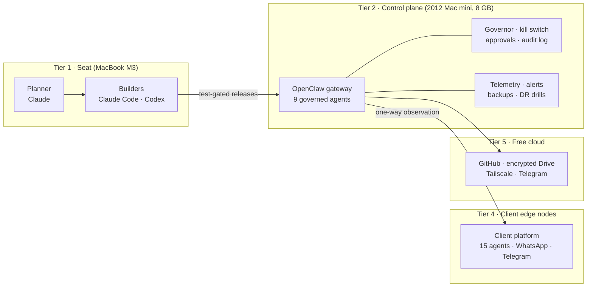
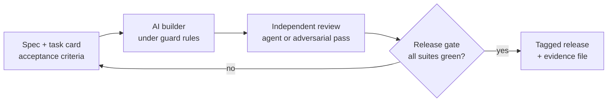
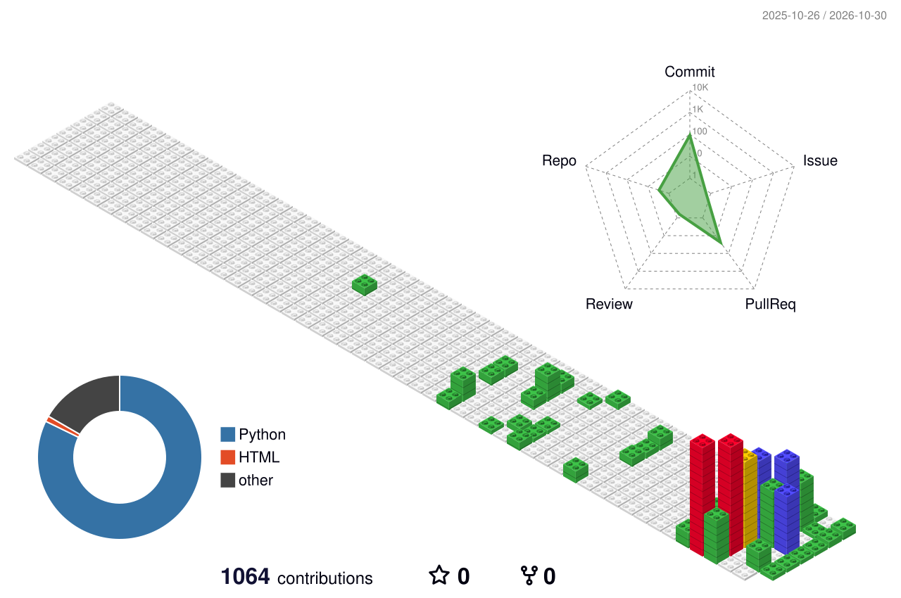

<!-- Profile README v3 · source of truth: TECH_PROFILE_MASTER (verified claims only) · built by scripts/build_assets.py + .github/workflows -->

**Dr. Ravi Teja Thiriveedhi** · clinician turned AI systems architect · I design, ship and govern production multi-agent systems, with 20 years of clinical practice and hospital operations behind every decision. Hyderabad, India · open to remote roles (IST, UTC+5:30).

**Start here:** [WhatsApp agent case study](https://github.com/sterilefield/whatsapp-agent-case-study) (a live client system) · [Agent governance kit](https://github.com/sterilefield/agent-governance-kit) · [LLM token economics](https://github.com/sterilefield/llm-token-economics) · [All showcases](https://github.com/sterilefield)

**Try the live demos (invented data, run in your browser):** [Agent governance gate](https://sterilefield.github.io/agent-governance-kit/) · [Owner approval desk](https://sterilefield.github.io/whatsapp-agent-case-study/) · [Heartbeat token calculator](https://sterilefield.github.io/llm-token-economics/) · [Control plane playground](https://sterilefield.github.io/empire-os-reference-architecture/)

**Contact:** [dr.raviteja1981.new@gmail.com](mailto:dr.raviteja1981.new@gmail.com) · [LinkedIn](https://www.linkedin.com/in/dr-ravi-teja-thiriveedhi) · private walkthroughs of my own production systems on request, under NDA (client systems only with the client's permission)

<picture>
  <source media="(prefers-color-scheme: dark)" srcset="assets/hero-dark.svg">
  
</picture>

  <picture>
    <source media="(prefers-color-scheme: dark)" srcset="assets/typing-dark.svg">
    
  </picture>

<picture>
  <source media="(prefers-color-scheme: dark)" srcset="assets/proof-dark.svg">
  
</picture>

## Hello, I'm Ravi

For twenty years I ran the operating side of healthcare: I treated patients, founded two healthcare facilities and ran a third as senior administrator, and wrote the SOPs, audits and financial controls that kept them safe and solvent. In 2026 I brought that operator discipline to AI. I now **design, ship and govern production multi-agent systems** — and make them pay for themselves.

<picture>
  <source media="(prefers-color-scheme: dark)" srcset="assets/bullets-dark.svg">
  
</picture>

> [!NOTE]
> Most of my production work is private (client systems and my own platform). The contribution graph shows that activity; the case studies below explain it. Sanitised public showcases are published under **[Sterile Field](https://github.com/sterilefield)** — clean-room engineering for healthcare AI — as each one passes a five-gate release check.

## Showcases at a glance

<table>
<tr>
<td width="50%"> <a href="https://github.com/sterilefield/whatsapp-agent-case-study"><b>WhatsApp agent case study</b></a> · <a href="https://sterilefield.github.io/whatsapp-agent-case-study/">live demo</a></td>
<td width="50%"> <a href="https://github.com/sterilefield/agent-governance-kit"><b>Agent governance kit</b></a> · <a href="https://sterilefield.github.io/agent-governance-kit/">live demo</a></td>
</tr>
<tr>
<td width="50%"> <a href="https://github.com/sterilefield/llm-token-economics"><b>LLM token economics</b></a> · <a href="https://sterilefield.github.io/llm-token-economics/">live demo</a></td>
<td width="50%"> <a href="https://github.com/sterilefield/empire-os-reference-architecture"><b>Empire OS reference architecture</b></a> · <a href="https://sterilefield.github.io/empire-os-reference-architecture/">live demo</a></td>
</tr>
</table>

## Hire me for

| Track | What I bring | Evidence |
|---|---|---|
| 🩺 **Health-tech AI** | 20 years of clinical and hospital operations, plus AI built for regulated care: consent-first, no clinical advice, human hand-off | [WhatsApp case study](https://github.com/sterilefield/whatsapp-agent-case-study) (human takeover, owner-approved messaging) |
| 🚀 **AI startups · forward-deployed** | Two production multi-agent platforms shipped spec-first with Claude Code and Codex, from architecture to on-call | [Empire OS reference architecture](https://github.com/sterilefield/empire-os-reference-architecture) · [WhatsApp case study](https://github.com/sterilefield/whatsapp-agent-case-study) |
| 🛡️ **AI governance** | Autonomy levels, risk classes, kill switches, approval gates, audit trails; OWASP Agentic Top 10, NIST AI RMF and DPDP mapping | [agent-governance-kit](https://github.com/sterilefield/agent-governance-kit) |
| 💸 **LLM cost engineering** | 46 token-economics methods across 5 layers (18 published in `llm-token-economics`); measured before/after on live systems | [llm-token-economics](https://github.com/sterilefield/llm-token-economics): −91% heartbeat tokens · ₹0 marginal API cost per lead |

## What I've built in 2026

<table>
<tr>
<td width="50%" valign="top">

### Tejas Empire OS
Self-hosted multi-agent AI operating system that runs my businesses.

- **9 live agents** with routing, delegation and human-approval tiers
- **626+ commits**, 8 releases in 7 days (v1.0.0 → **v1.3.0**, 7–13 Oct 2026), **99/99** release gate, **1,026** automated tests with 0 failures
- ADR-driven: 12 founding decisions, 56 design documents
- Runs on a **2012 Mac mini (8 GB)** under a written RAM budget and memory governor

</td>
<td width="50%" valign="top">

### Real-estate AI operations platform
Built for a Hyderabad brokerage (client anonymised). Live since June 2026.

- **15 agents** on the WhatsApp Business API and Telegram
- **460+ leads** captured, qualified and followed up; single-writer SQLite spine
- Heartbeat tokens **12 M → 1 M a day (−91%)**; **₹0 marginal API cost** per lead
- 129 bugs fixed with cause, fix and lesson; 75 lessons, 61 reused

</td>
</tr>
<tr>
<td width="50%" valign="top">

### Dental WhatsApp Front Desk
Administrative-only assistant for small dental clinics.

- Consent-first (DPDP), never diagnoses or advises; urgent words trigger emergency wording
- HMAC-verified webhooks, replay protection, quarantine on corrupt state
- **17 offline tests**, including a signed 14-day synthetic pilot

</td>
<td width="50%" valign="top">

### Clinical engineering
Two decades of building where the textbook ran out.

- DICOM / CBCT → STL → 3D-printed models: treatment acceptance **+50–60%**
- Compressed-air PPE isolation suite that kept a clinic open in 2020, at 50–60% lower PPE cost
- WhatsApp and Telegram clinic bots on n8n since 2024

</td>
</tr>
</table>

## Architecture at a glance

## How I build

I practise **disciplined vibe coding**: I write the spec, the acceptance criteria and the guard rules; AI coding agents write the code; I own architecture, review, testing, release and operations.

## Latest

<!-- LATEST:START -->
**Public showcases**

- 🧪 [sterilefield/llm-token-economics](https://github.com/sterilefield/llm-token-economics) — Case study + playbook: an AI agent fleet cut heartbeat tokens 12.0M to 1.0M a day (-91%). 18 methods across 5 groups, with measured before/after.
- 🧪 [sterilefield/agent-governance-kit](https://github.com/sterilefield/agent-governance-kit) — Autonomy levels, risk classes, approval tiers, kill switches and audit for AI agents, mapped to OWASP Agentic Top 10, NIST AI RMF and ISO/IEC 42001, with a healthcare overlay for India.
- 🧪 [sterilefield/empire-os-reference-architecture](https://github.com/sterilefield/empire-os-reference-architecture) — Reference architecture: 9 governed AI agents on an 8 GB Mac mini, 99/99-suite release gate, 1,026 tests. Sanitised showcase of Empire OS.
- 🧪 [sterilefield/whatsapp-agent-case-study](https://github.com/sterilefield/whatsapp-agent-case-study) — Anonymised case study: a 15-agent WhatsApp and Telegram operations platform for a real-estate brokerage. Single-writer data spine, human-in-charge policy, −91% heartbeat tokens.

**Latest releases**

- 🚀 [agent-governance-kit v0.1.0](https://github.com/sterilefield/agent-governance-kit/releases/tag/v0.1.0) · 2026-10-14
- 🚀 [whatsapp-agent-case-study v0.1.0](https://github.com/sterilefield/whatsapp-agent-case-study/releases/tag/v0.1.0) · 2026-10-14
- 🚀 [empire-os-reference-architecture v0.1.0](https://github.com/sterilefield/empire-os-reference-architecture/releases/tag/v0.1.0) · 2026-10-14
- 🚀 [llm-token-economics v0.1.0](https://github.com/sterilefield/llm-token-economics/releases/tag/v0.1.0) · 2026-10-14

Updated automatically by GitHub Actions.
<!-- LATEST:END -->

## Activity

<picture>
  <source media="(prefers-color-scheme: dark)" srcset="profile-3d-contrib/profile-night-rainbow.svg">
  
</picture>

<b>Career record</b> · 20 years of clinical, operational and entrepreneurial work

| Years | Role |
|---|---|
| 2026 – now | Architect and operator, Tejas Empire OS; architect and builder of a client AI operations platform |
| 2019 – now | Founder and lead engineer, INGENIUM 3D (clinical 3D printing studio) |
| 2010 – 2025 | Founder and chief dental surgeon, DV Dental Hospital & Implant Centre (team of 26) |
| 2010 – now | Senior administrator, Manjary Nursing Home |
| 2007 – now | Founder · senior clinical systems architect · senior administrator and dental surgeon, Manjary Dental Care Centre |
| 2013 – 2019 | Founder and CEO, Shree Manjary Medical Agency (clean exit) |
| 2006 – 2010 | Associate dentist → branch head → regional clinical administrator, a 9-branch dental hospital group |

**Education:** BDS, Rajiv Gandhi University of Health Sciences (course 2000–2005, internship 2006); registered dental surgeon, AP State Dental Council (since 2010). **Languages:** English, Telugu, Hindi, Kannada.

<b>Toolbox</b>

 

**Languages and platforms:** Node.js · Python · TypeScript · React · Vite · SQLite · Git · GitHub Actions · Docker · Figma · Linux · macOS
**AI and agents:** Claude (Code, MCP, Projects) · OpenAI GPT and Codex · Gemini · OpenClaw · MCP servers · open-weight models via Ollama · RAG (LanceDB, ChromaDB, LlamaIndex) · promptfoo evals
**Ops:** macOS launchd · Tailscale · GitHub Actions · gitleaks · osv-scanner · Playwright · backups and DR drills
**Integrations:** WhatsApp Business API · Telegram · Google Workspace APIs · n8n
**Clinical tech:** DICOM / CBCT → 3D printing (Bambu, OrcaSlicer) · EMR

## Contact

  <a href="https://www.linkedin.com/in/dr-ravi-teja-thiriveedhi"><b>LinkedIn</b></a> ·
  <a href="mailto:dr.raviteja1981.new@gmail.com"><b>Email</b></a> ·
  Hyderabad, India · open to remote roles (IST, UTC+5:30)

<picture>
  <source media="(prefers-color-scheme: dark)" srcset="https://raw.githubusercontent.com/Raviteja2k2k/Raviteja2k2k/output/github-snake-dark.svg">
  
</picture>

Engineering numbers come from the linked repositories, release notes and case studies. Operational figures are from my own records and are not independently audited. Graphics are generated by this repository's own workflows.
